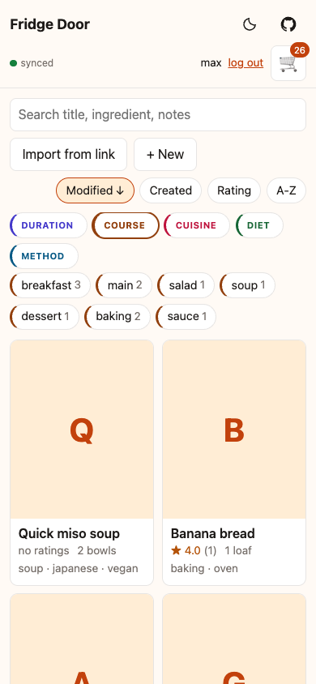
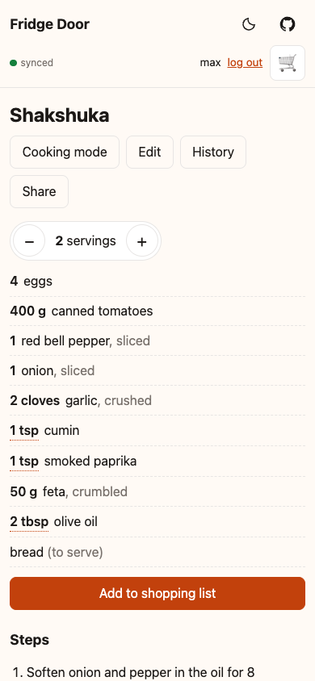
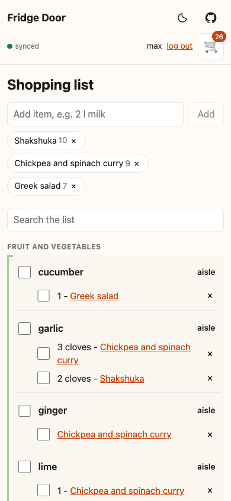
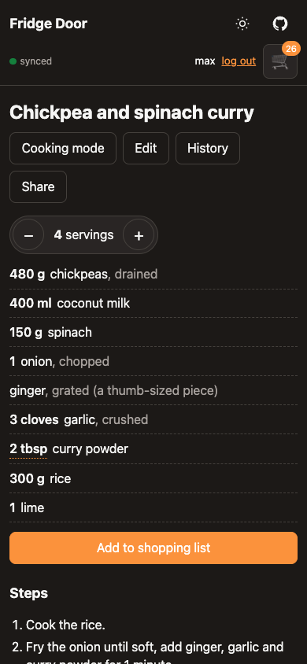

# Fridge Door

A shared recipe box and shopping list for a household of two, built as an installable,
offline-first web app on Cloudflare Workers.

<p>
  
  
  
  
</p>

The screenshots show the demo data from `seed/seed.sql` (`npm run dev` loads it).

## Features

- **Recipes** with structured ingredients in sections, ranges ("2-3 cloves"), markdown steps and
  notes, yield, total and active time, source link and a cover image with a chosen focal point.
- **Scaling** by servings or by factor, with per-unit rounding and g/ml promoted to kg/l.
- **Cooking mode**: bigger text, screen kept awake, tap to tick off steps and ingredients.
- **Ratings and comments** per person, markdown comments with preview.
- **Tags** in groups (`course:main`, `cuisine:thai`, `list:next-up`, ...), defined once in
  `shared/tags.ts`. The list filters by group and searches titles, ingredients, tags and notes.
- **Shopping list** shared between both people, filled from a recipe at its current scale. Items
  are grouped by ingredient base ("red apple" and "apples" are one "apple") under aisle headings,
  in one household aisle order that either person can reorder. Moving an item to another aisle
  teaches the catalogue.
- **Ingredient catalogue** in D1 (`shared/catalogue.ts`): canonical bases with aliases and an aisle.
  Every saved ingredient gets a base through catalogue lookup, deterministic rules, or Claude
  Haiku for unknown names. Successful model answers become `auto` entries for review. Without AI,
  unknown names keep a rule-derived base. Recipe search matches bases too, so "apples" finds "red apple".
- **Offline first**: the app shell is cached by a service worker, data lives in IndexedDB, and
  edits made offline (shopping items, ratings, tags, comments, cover crop) sync when back online.
- **Version history** for every recipe, with a diff and restore.
- **Import from a link**: paste a recipe URL (or share it from the phone) and Claude turns the
  page into a draft in the editor. Without an API key, pages with schema.org Recipe data are still
  mapped field by field.
- **MCP server** at `/mcp`, so Claude (claude.ai connectors, Claude Code) can search, read, create
  and edit recipes as one of the two people.
- **Appearance** with a header light/dark switch. The app follows your system until you choose
  a theme, then remembers that choice on the device. The header also links to the GitHub repository.
- **Login** with Google or GitHub, limited to an allowlist.

## When ingredient classification uses AI

Classification runs on the server when a recipe is saved. This covers editor creates and edits,
MCP creates and updates, saved URL imports, changed batch imports, and revision restores.
Reading recipes, searching, and opening the shopping list do not trigger classification.

For each ingredient, the resolver tries these steps in order:

1. Look up its name in the catalogue of bases and aliases.
2. Apply deterministic rules, such as singularizing and removing preparation or size words,
   then look up the result again. Product-changing words such as "dried" and "ground" stay.
3. Send remaining unknown names to Claude Haiku in batches of up to 60 names. The model proposes
   a canonical base and aisle. Successful answers are stored with origin `auto`, so later uses
   normally resolve without another model call.

Shopping items also pass through the resolver when added or submitted during sync. Only live
items without a base can trigger AI. An item with a base but no aisle gets its aisle from the
catalogue. Items that already have both fields skip classification. Offline additions appear
immediately and can be classified when they sync. Adding a known recipe ingredient to the list
normally needs no model call.

The [recipe backfill](docs/DEPLOY.md#ingredient-bases-for-existing-recipes) also enables AI for
unknown names. It processes existing recipes in pages and can be rerun after AI becomes available.
A manual aisle move updates the catalogue with origin `user` without calling a model. The MCP
`set_ingredient` correction re-resolves recipes without AI. User corrections take priority over
automatic catalogue entries.

Classification requires `ANTHROPIC_API_KEY`. Without a key, during a recorded outage, or after a
model failure, unknown names keep a rule-derived base under **Other**. The resolver does not store
that fallback as a learned catalogue entry, so later recipe saves or backfill runs can retry.
Credit exhaustion or a rejected key pauses AI calls for one hour. Unknown ingredients can delay
a save while the server waits for the model, with a 20-second timeout per batch.

Shopping rows that already carry a fallback base and aisle skip later classification. They do not
automatically retry when AI recovers. The recipe backfill places live shopping rows again, so they
regroup after the catalogue changed.

This classifier is separate from the model that extracts a recipe from a URL. Saving the imported
recipe runs ingredient resolution after extraction.

## Architecture

One Worker serves the built SPA and a Hono JSON API under `/api`. Every request goes through the
Worker first (`assets.run_worker_first`), so the login check covers the static files too.

```
shared/      zod schemas and types shared by client and server, tag scheme, line parser,
             scaler, search, lint rules for recipe content
worker/      entry with the MCP OAuth provider (index.ts), Hono app (app.ts), D1 access (repo.ts),
             login (auth.ts, session.ts), MCP consent page (oauth.ts) and tools (mcp.ts),
             covers on R2 (covers.ts), link import (urlImport.ts, pageFetch.ts, extract.ts,
             recipeLlm.ts, ldDraft.ts)
src/         React 19 client: pages, components, lib (router, signal, api client),
             store (IndexedDB, outbox, sync)
sw/sw.js     hand-written service worker; sw-plugin.ts injects the precache list at build time
migrations/  D1 schema
seed/        four demo recipes with ratings and comments
import/      normalization contract (NORMALIZE.md) and tooling for a one-off Asana import
```

Storage:

| binding | type | holds |
|---|---|---|
| `DB` | D1 | recipes, ratings, comments, shopping items, revisions, link-import log, ingredient catalogue, aisle order |
| `COVERS` | R2 | cover images, keyed by content hash |
| `OAUTH_KV` | KV | MCP OAuth clients, grants and tokens |

The client renders from IndexedDB first and revalidates from `/api`. Offline writes are applied
optimistically and queued in an outbox of idempotent requests. The shopping list merges per item
with last-write-wins on the edit time and tombstones for deletes, and polls with a server
revision cursor.

The app has exactly two users, with the fixed ids `max` and `partner` (`USERS` in
`shared/constants.ts`). The allowlists map Google emails and GitHub user ids to these ids.

## Local development

Needs Node 22 or newer (the worker tests use `node:sqlite`).

```sh
npm ci
npm run dev
```

`npm run dev` copies `wrangler.example.jsonc` to `wrangler.jsonc` and `.dev.vars.example` to
`.dev.vars` when they are missing, applies the migrations to a local D1, seeds the demo recipes
and serves the app on http://localhost:8788.

OAuth providers cannot redirect back to localhost, so `.dev.vars` sets `DEV_LOGIN=true`. The login
page then offers "log in as max" and "log in as partner". Dev login also requires a localhost or
127.0.0.1 host, and `wrangler deploy` never uploads `.dev.vars`, so it cannot work on a deployed
Worker. Open a normal and a private window to act as both people at once.

Link import needs `ANTHROPIC_API_KEY` in `.dev.vars`. Without it the import still works without AI.

Other scripts:

```sh
npm run build       # dist/client (assets and sw.js) and the Worker bundle
npm run preview     # the production build on :8788; the service worker only runs here
npm run db:reset    # wipe the local D1, migrate and seed again
```

To try offline mode, run `npm run build && npm run preview`, open a few recipes, then switch
DevTools to offline and reload.

## Tests

```sh
npm run check       # tsc for the app, the Worker, the node scripts and the Worker tests
npm test            # vitest
```

The worker tests in `test/worker/` run the real Hono app and OAuth provider against the real
migrations on `node:sqlite`, with an in-memory R2 and KV and a fake network. They need no
Cloudflare account and no `wrangler.jsonc`.

## Deploy

See [docs/DEPLOY.md](docs/DEPLOY.md) for a deploy from zero: D1, R2 and KV, OAuth apps, secrets,
allowlists, staging, a custom domain and connecting Claude over MCP.

## License

MIT, see [LICENSE](LICENSE).
